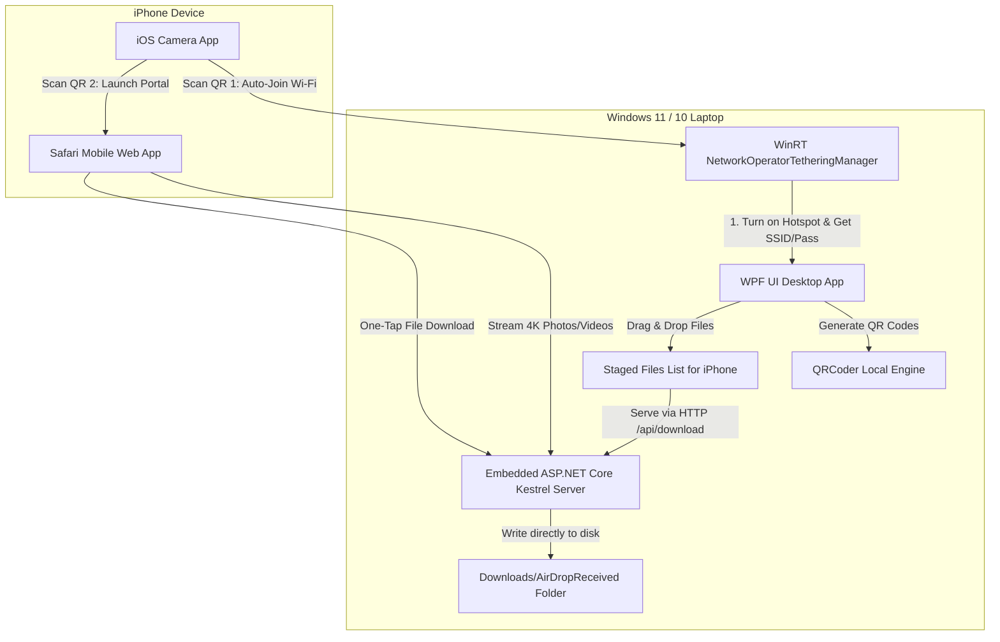

# AirDrop Windows (WPF / .NET 8)

A high-speed, zero-install local Wi-Fi file-sharing utility between a Windows laptop/PC and an iPhone. Built with **WPF / C# (.NET 8)**, **Windows 11 Fluent UI**, native **WinRT Mobile Hotspot APIs**, and an embedded **ASP.NET Core Kestrel** server.

---

## Architecture Overview



---

## Key Features

### 1. Windows Native Mobile Hotspot Control
- **WinRT Integration**: Utilizes `Windows.Networking.NetworkOperators.NetworkOperatorTetheringManager` via `<TargetFramework>net8.0-windows10.0.19041.0</TargetFramework>` to programmatically turn the PC's Mobile Hotspot on or off.
- **Credential Detection**: Automatically reads the system-assigned Wi-Fi SSID and WPA2 security passphrase.
- **Client Device Monitoring**: Scans connected clients (`GetTetheringClients()`) to display connected iPhones with hostname, IP address, and MAC address.
- **Dynamic IP Discovery**: Automatically detects the hotspot adapter IP (defaulting to `192.168.137.1`).

### 2. Instant QR Code Pairing (No iPhone App Required)
- **Wi-Fi QR Code**: Encoded using standard `WIFI:S:<SSID>;T:WPA;P:<Password>;;` format. When scanned by the native iOS Camera app, iOS prompts: *"Join '[Network Name]' Network?"* for one-tap connection.
- **Web App QR Code**: Encoded with the local server URL (e.g. `http://192.168.137.1:8765`). Scanning this in the Camera app instantly launches the transfer portal in Safari.

### 3. Embedded High-Speed HTTP Web Server
- **In-Process Kestrel Server**: Runs ASP.NET Core Kestrel in-process without needing IIS or manual URL ACL registrations (`netsh http add urlacl`).
- **Dynamic Port Allocation**: Uses `GetAvailablePort(8765)` to automatically find an open TCP port, avoiding port collisions with existing services (e.g. Apache, IIS, or dev servers on port 8080).
- **Direct Disk Streaming**: Handles multi-gigabyte files (e.g. 4K ProRES iPhone videos) using chunked `FileStream` buffers (128 KB) with `MaxRequestBodySize = null`, bypassing RAM buffering to prevent OutOfMemory exceptions.
- **Real-Time Speed Calculation**: Emits byte progress events and computes transfer speeds in MB/s for both the web app and desktop UI.

### 4. iOS-Optimized Web App (Safari)
- Glassmorphism dark-mode UI designed following Apple Human Interface Guidelines.
- **Send to PC (iPhone → Windows)**: Multi-file picker with photo library support, progress bars, real-time upload speed (MB/s), and automatic storage into `Downloads\AirDropReceived`.
- **Download from PC (Windows → iPhone)**: Real-time listing of files queued on the PC with direct download links.

### 5. Windows Desktop UI
- Styled with **WPF-UI** (Windows 11 Fluent design).
- Interactive drag-and-drop dropzone for staging files to share with iPhone.
- Live transfer monitor with progress bars, transfer speeds, and status badges.
- One-click button to open the `AirDropReceived` folder in Windows File Explorer.

---

## Prerequisites & Requirements

- **Operating System**: Windows 10 (version 2004 / build 19041 or higher) or Windows 11.
- **Hardware**: Wi-Fi adapter with Hosted Network / Wi-Fi Direct support (standard on modern laptops).
- **Runtime**: .NET 8 Desktop Runtime or .NET 8 SDK.

---

## Running the Application

### Option A: Run the Pre-compiled Executable (Fastest)
From PowerShell in the project root:
```powershell
.\bin\Debug\net8.0-windows10.0.19041.0\AirDropWindows.exe
```

### Option B: Run via .NET SDK
If running via the .NET CLI:
```powershell
# Using the installed .NET 8 SDK (x86 path):
& "C:\Program Files (x86)\dotnet\dotnet.exe" run
```

*(Tip: To enable standard `dotnet run`, add the x86 SDK to your path: `$env:Path = "C:\Program Files (x86)\dotnet;" + $env:Path`, or install the x64 .NET 8 SDK from [Microsoft](https://dotnet.microsoft.com/download/dotnet/8.0)).*

---

## Step-by-Step User Guide

### 1. Start the Hotspot
1. Launch **AirDrop Windows**.
2. Click the **Windows Mobile Hotspot** toggle switch to turn it on.
3. The app will display your hotspot's **Network (SSID)**, **Password**, and active **Web Server URL**.

### 2. Connect Your iPhone
1. Open the native **Camera app** on your iPhone.
2. Point the camera at **QR Code 1 (Join Wi-Fi)** on your PC screen.
3. Tap the yellow banner: **"Join '[Network Name]' Network"**.
4. Point the camera at **QR Code 2 (Open Transfer)**.
5. Tap the banner to open the web portal in **Safari**.

### 3. Transfer Files
- **To Send Files from iPhone to Windows**:
  1. On the iPhone web page, tap **"Send to PC"**.
  2. Tap the upload area to choose photos, videos, or documents from the Files app.
  3. Tap **"Send to Windows PC"**.
  4. Files stream directly to `Downloads\AirDropReceived` on your PC at full Wi-Fi speeds.
  5. Click **"Open Received Folder"** on the PC app to access them.

- **To Send Files from Windows to iPhone**:
  1. On the PC app, drag and drop files into the **"Send Files to iPhone"** zone (or click **"Browse Files"**).
  2. On the iPhone web page, switch to the **"Download from PC"** tab.
  3. Tap **"Save"** next to any file to download it to your iPhone.

---

## Project Structure

```
airdrop_windows/
├── Assets/
│   └── webapp.html             # iOS Safari glassmorphism web application
├── Models/
│   ├── ConnectedClient.cs      # Connected device details (MAC, IP, Hostname)
│   ├── SharedFileItem.cs       # Files queued on PC for iPhone download
│   └── TransferItem.cs         # Active and completed transfer progress model
├── Services/
│   ├── FileTransferServer.cs   # Embedded ASP.NET Core Kestrel HTTP server
│   ├── HotspotService.cs       # WinRT Windows Mobile Hotspot manager
│   └── QRCodeService.cs        # QRCoder generator for Wi-Fi & Web URLs
├── ViewModels/
│   └── MainViewModel.cs        # Application state, polling, and commands
├── AirDropWindows.csproj       # Project configuration (WinRT + Kestrel + WPF-UI)
├── App.xaml                    # Application startup & WPF-UI themes
├── app.manifest                # High-DPI (PerMonitorV2) & Windows compatibility
├── Converters.cs               # WPF value converters
├── MainWindow.xaml             # Fluent desktop application view
└── MainWindow.xaml.cs          # Code-behind for drag & drop and UI events
```

---

## Technical Details

### WinRT Mobile Hotspot Control
Windows 10 (1809+) and Windows 11 expose mobile hotspot management via the `Windows.Networking.NetworkOperators.NetworkOperatorTetheringManager` class:
```csharp
// Acquire manager from the current connection profile
var profile = NetworkInformation.GetInternetConnectionProfile() 
    ?? NetworkInformation.GetConnectionProfiles().FirstOrDefault();

var manager = NetworkOperatorTetheringManager.CreateFromConnectionProfile(profile);

// Asynchronously toggle hotspot
var result = await manager.StartTetheringAsync();
if (result.Status == TetheringOperationStatus.Success)
{
    var config = manager.GetCurrentAccessPointConfiguration();
    // config.Ssid, config.Passphrase
}
```

### High-Speed Multipart Streaming
To handle massive files (such as 4K 60fps video recordings) without consuming gigabytes of system memory, uploads stream directly from the incoming HTTP request stream to a disk `FileStream` using a 128 KB buffer:
```csharp
const int bufferSize = 128 * 1024;
byte[] buffer = new byte[bufferSize];

using var src = formFile.OpenReadStream();
using var dest = new FileStream(destinationPath, FileMode.Create, FileAccess.Write, FileShare.None);

int bytesRead;
while ((bytesRead = await src.ReadAsync(buffer, 0, buffer.Length)) > 0)
{
    await dest.WriteAsync(buffer, 0, bytesRead);
    // Real-time speed calculation & WPF UI update
}
```

---

## Troubleshooting & FAQ

### 1. "Mobile Hotspot failed to start"
- **Wi-Fi disabled**: Ensure your PC's Wi-Fi adapter is enabled.
- **Hosted network support**: Verify that your wireless card supports Wi-Fi sharing by running `netsh wlan show drivers` in PowerShell and checking `Hosted network supported: Yes`.
- **Administrator privileges**: If your laptop is managed by organization group policies, run the application as Administrator.

### 2. "iPhone cannot reach the web page after connecting"
- Ensure Mobile Data / Cellular is temporarily disabled on the iPhone if iOS attempts to route local IP requests over cellular data.
- Check Windows Defender Firewall: If prompted, allow `AirDropWindows.exe` access on Private networks.

### 3. "Port conflict / Address already in use"
- The application automatically scans for an open port starting at `8765`. If another service occupies that port, it dynamically binds to an available system port and updates the QR code accordingly.

---

## License
MIT License. Free for personal and commercial use.
